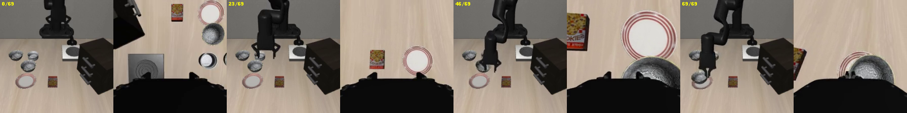
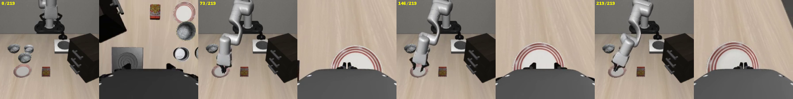
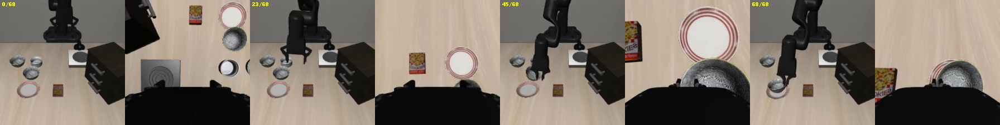

# 실험 6 — 몸체 차이의 도메인 벡터는 어느 모듈에 담기나 (시각 × 동역학 2×2)

H1 시각 가설: δ 의 효과가 vision+VLM 에 담김 / H2 액션 가설: action expert 에 담김.

| 조건 | XARM7_COLOR | XARM7_DYNAMICS | 상태 |
|---|---|---|---|
| v0 | white | panda | 단계 0 (마스크 4개 + 같은 잡 θ0·θ* 재평가) |
| v1 | dark | panda | 단계 3: 평가 7개 완료 |
| v2 | white | robosuite | 단계 3: 평가 7개 완료 |
| v3 | dark | robosuite | 단계 3: 평가 7개 완료 |

고정 (모든 조건): libero_spatial task 0 demo_0 데모, Panda init state → xArm7 IK 전이, 카메라, XARM7_INIT_QPOS, seed 7,
FT (pi05_libero_oneshotft, batch 64, 1000 step), 평가 (10 태스크 × 10 에피소드, t0 = adapt, t1~9 = held-out), α = 0.5, 합성 = 공식 CPU.
θ_src 는 v0 것을 모든 조건이 공유.

**규칙 4 (2026-10-22 수정):** dart 저장소·LIBERO-view 서브모듈의 **학습 로직은 무수정, 저장·로그 패치만 v0 와 동일하게 적용**한다.
- 적용하는 패치: **v0 와 동일하게 `patches/dart_oneshot_ft.patch` 적용** (3곳, 모두 저장·로그):
  - `checkpoints.py`: `OPENPI_SAVE_TRAIN_STATE=0` 이면 train_state 를 저장하지 않음
  - `train.py`: JAX 컴파일 캐시 경로를 `JAX_COMPILATION_CACHE_DIR` 로
  - `finetune.sh`: `EXTRA_ARGS` (`--log-interval=10 --overwrite`)
- 잡 130582 에서 2026-10-22 적용. `git diff` 가 패치 파일과 바이트 단위로 동일 (sha256 `df7b581f…e23c`), HEAD 1b23c4f.
- 그 밖의 추가 코드는 `~/hayeon/dart_xarm7/` 아래 신규 파일, 또는 `libero_xarm7/__init__.py` 의 환경변수 분기로만.

---

## 단계 0 — v0 마스크 평가 (2026-10-21, 잡 130582, ece-agpu7)

### 0-1. 환경 복원 (18:30 → 18:57, 27분)
- 새 잡이라 `$DART_ROOT` 없음. **`/var/tmp` 여유 10G (98%)** 라 복원 필요량(≈37G)이 안 들어감 →
  `$DART_ROOT=/var/tmp/pbs.130582.ECE-util1/dart` 를 **`/dev/shm/introai34_dart_130582` 로 가는 링크**로 둠 (env.sh 무수정).
- 명령: `DART_SHM=/dev/shm/introai34_dart_130582 setsid nohup bash ~/hayeon/dart_xarm7/restore_env.sh &` (신규 스크립트, 로그 `$DART_ROOT/logs/restore/`)

| 단계 | 시간 | 결과 |
|---|---|---|
| clone @1b23c4f + 서브모듈 | 141s | aloha d1dc83a, libero f78abd6, libero-view 2e8af0f (ENV_STATUS 와 같음) |
| uv sync | 498s | rc=0 |
| OSMesa (conda-forge mesalib<25) | 811s | libOSMesa.so.8 |
| 평가 venv dart-libero | 950s | torch = 이미지 2.1.0a0+32f93b1 (`/usr/local/lib/python3.10/dist-packages`) |
| θ0 pi05_libero | 987s | 12,439,086,321 B (`du -sb`, 디렉터리 포함) |
| HF 체크포인트 (`fetch_ckpts_hf.py`) | 597s | 아래 |

HF `qoranreh/dart-xarm7-oneshot` → v0 경로, 파일 수·크기 HF 메타데이터와 대조:
- `oneshot_src/` → `$DART_ROOT/ckpts/oneshot_src/pi05_libero_oneshotft/original/999` — 63/63 파일, 크기 일치, 4.90 GiB
- `oneshot_tgt/` → `$DART_ROOT/ckpts/oneshot_tgt/pi05_libero_oneshotft/original/999` — 58/58, 일치, 4.90 GiB
- `dart_a0.5/` → `$DART_ROOT/ckpts/dart_a0.5` — 38/38, 일치, 4.90 GiB

확인: `.venv` 에서 openpi import·`CudaDevice(id=0)`·`get_config('pi05_libero')`, `$LIBERO_PY` 에서 xArm7 libero_spatial t0 env 생성·OSMesa 렌더 OK.
이상 징후: HF 다운로드 중 xethub DNS 일시 실패 경고 (재시도로 정상 완료).

### 0-2. 러너 `run_eval_masked.sh` (신규)
- `run_eval_model.sh` 복제. 서버만 `~/hayeon/dart_exp2/serve_masked.py` (무수정), 준비 판정 `"Serving modules"`, 포트 9100, config 기본 pi05_libero.
- COND→env 매핑을 스크립트 안에 고정 (v0 white/panda, v1 dark/panda, v2 white/robosuite, v3 dark/robosuite, 그 외 에러).
  클라이언트를 띄우기 전에 `libero_xarm7.DYNAMICS` 가 env 와 같은지, `XARM7_COLOR` 가 white 가 아니면 모듈에 COLOR 분기가 있는지 확인 → 지금은 v0 만 통과.
- 결과 폴더가 이미 있으면 거부 (`OVERWRITE=1` 로만 덮어씀) — 10/10 결과 보호. `meta.txt` 에 조건·env·경로·모듈별 파라미터 수·시간 기록.
- 모듈 크기 (serve_masked 로그): vision 0.415B, VLM 2.509B, expert 0.430B (합 3.354B).

### 0-3. 정합성 확인 (task 0 × 10, `bash run_exp6_stage0.sh check`)

| 태그 | modules | t0 | 기준 (10/10 실행) | 이전 실행 (10/09) |
|---|---|---|---|---|
| v0_check_none | none (= θ0) | **4/10** | theta0 7/10 | 3/10 |
| v0_check_all | all (= θ*) | **9/10** | dart_a0.5 7/10 | (다른 θ*) 9/10 |

- none 이 기준과 3 차이 (±2 를 넘음) → 본 평가 전에 원인 확인: `check_masked_equiv.py` (신규).
  serve_masked.main 을 그대로 호출(서버만 가짜)한 정책과 `create_trained_policy` 정책에, 같은 웜업 3회 후 같은 임의 관측 4개를 넣어 행동 비교
  (openpi Policy rng 는 key(0) 에서 시작 → 결정적).
  **none ≡ θ0, all ≡ θ* — 행동 4개 모두 비트 단위 동일.** → 파라미터 키 구조·norm_stats·config 문제 아님.
- 같은 θ0 의 t0 가 실행마다 3/10, 7/10, 4/10 (에피소드별 성공 패턴도 실행마다 다름) → pi05 샘플링 노이즈. 4/10 vs 7/10 Fisher p=0.37.
  t0 10 에피소드는 노이즈가 커서 비교는 held-out 90 에피소드로 한다 (EVAL_RESULTS.md 와 같은 결론).

### 0-4. 본 평가 (`setsid nohup bash run_exp6_stage0.sh main`, 19:08:45 → 21:15:36, 2시간 7분)
조건 v0 (XARM7_COLOR=white, XARM7_DYNAMICS=panda — 각 `results/<태그>/meta.txt` 에 기록), BASE = θ0, TUNED = `$DART_ROOT/ckpts/dart_a0.5`,
서버 1개씩 순차, 10 태스크 × 10 에피소드, 클라이언트 5개. 모델당 19.6~22.9분. 6개 모두 100 에피소드, **errors 0**, client_fail 0.

**표 1 — v0 성공률** (`summarize_exp6.py --cond v0`)

| 모델 | 태그 | adapt t0 | held-out t1–9 (95% CI) | t0~t9 |
|---|---|---|---|---|
| θ0 | `v0_theta0` | 5/10 | 53/90 = **59%** (49–68) | 5 6 8 5 4 2 9 6 9 4 |
| θ* α=0.5 | `v0_dart_a0.5` | 8/10 | 65/90 = **72%** (62–80) | 8 10 10 10 4 3 10 5 10 3 |
| mask vision | `v0_mask_vision` | 10/10 | 69/90 = **77%** (67–84) | 10 10 10 10 4 2 10 8 10 5 |
| mask VLM | `v0_mask_vlm` | 8/10 | 62/90 = **69%** (59–78) | 8 10 9 7 7 1 9 8 7 4 |
| mask expert | `v0_mask_expert` | 4/10 | 54/90 = **60%** (50–70) | 4 8 8 3 5 3 10 4 10 3 |
| mask vision+VLM | `v0_mask_visionvlm` | 8/10 | 72/90 = **80%** (71–87) | 8 9 10 10 6 2 10 9 10 6 |
| (참고) θ0, 10/10 실행 | `theta0` | 7/10 | 49/90 = 54% (44–64) | |
| (참고) θ_tgt, 10/10 실행 | `theta_tgt` | 7/10 | 0/90 = 0% (0–4) | |
| (참고) θ* α=0.5, 10/10 실행 (같은 가중치) | `dart_a0.5` | 7/10 | 66/90 = 73% (63–81) | |

**표 2 — 격차 회복률 (held-out)**, 분모 = 같은 잡의 θ* − θ0 = 72.2 − 58.9 = **+13.3%p (12 에피소드, Fisher p=0.084)**

| δ 를 넣은 모듈 | held-out | − θ0 | 회복률 v0 (부트스트랩 95%) | p vs θ0 | p vs θ* | 회복률 (θ0 3회 합산 기준) | 실험 2 회복률 (시점 medium) |
|---|---|---|---|---|---|---|---|
| vision | 77% | +17.8%p | **133%** (0–700) | 0.016 | 0.61 | 125% (p=0.001) | 46% |
| VLM | 69% | +10.0%p | **75%** (−100–361) | 0.21 | 0.74 | 75% (p=0.048) | 51% |
| expert | 60% | +1.1%p | **8%** (−301–150) | 1.0 | 0.12 | 19% (p=0.71) | 3% |
| vision+VLM | 80% | +21.1%p | **158%** (44–900) | 0.003 | 0.29 | 146% (p=8e-5) | 79% |

- "θ0 3회 합산 기준": θ0 held-out 3회(10-09 52/90, 10-11 49/90, 오늘 53/90 = 154/270 = 57.0%), θ* 는 같은 가중치 2회(10-11 66/90 + 오늘 65/90 = 131/180 = 72.8%), 분모 +15.7%p. p 는 마스크 vs 합산 θ0.
- 실험 2 는 libero_spatial 500 에피소드 기준 (`dart_exp2/RESULTS.md`).

**해석 (v0 한정)**
1. **H1 쪽.** δ 의 이득은 vision·VLM 쪽에 있고, expert 에만 δ 를 넣으면 θ0 와 같다 (+1%p, p=1.0). 실험 2(시점 변화)와 같은 순서 (expert ≈ 0).
2. **vision 만 / vision+VLM 이 θ* 전체보다 높게 나옴** (77·80% vs 72%) → 회복률 >100%. θ* 와의 차이는 유의하지 않다 (p=0.61, 0.29).
   "expert δ 가 약간 해롭다"와 "노이즈"를 이 표본으로는 구분할 수 없다.
3. **회복률 자체는 v0 에서 해상도가 낮다.** 분모가 12 에피소드라 부트스트랩 구간이 수백 %. 마스크 간 비교는 회복률보다 "θ0 대비 차이 + p" 로 보는 게 안전하다.
   원인: v0 는 흰색·동역학 맞춤이라 도메인 차이가 작다 (θ0 가 이미 57~59%). v1~v3 에서 차이가 커지면 회복률의 해상도도 좋아질 것으로 예상 (추정).
4. 어려운 태스크는 그대로 남는다: t4 (서랍 속 그릇), t5 (ramekin 위). 모든 모델에서 1~7/10. t9 는 vision+VLM 6/10 이 최고.
5. 같은 잡 θ0 59% / θ* 72% 는 이전 실행 (θ0 54·58%, 같은 가중치 θ* 73%) 과 일치 → 서버 경로(serve_masked) 차이는 결과에 영향 없음 (0-3 의 비트 동일 확인과 일관).

이상 징후: 서버 로그에 `module 'jaxlib.xla_extension' has no attribute 'GpuAllocatorConfig'` 경고 (서빙·결과 정상).
러너가 meta.txt 에 모듈 줄을 grep 하면서 이 경고 줄까지 같이 적었음 → `grep -E "module (vision|vlm|expert)"` 로 고침 (단계 0 의 meta.txt 에는 경고 줄이 섞여 있음, 무해).
영상: `$DART_ROOT/eval/<태그>/videos/` (태스크별 ep0, 휘발성).

### 0-5. α 선택 분리 (오프라인, 10/10 실행 `results/{theta0,dart_a0.5,dart_a0.8,dart_a1.0}`)
jsonl 에 `episode`(= 공식 초기 상태 인덱스 0~9) 필드 있음 → 분리 가능. trial 0~4 의 held-out(t1~9, 45 에피소드)로 α 를 고르고 5~9 로 보고.

| 모델 | 선택용 held-out (trial 0–4) | 보고용 held-out (trial 5–9) |
|---|---|---|
| θ0 | 25/45 = 56% | 24/45 = 53% |
| θ* α=0.5 | **32/45 = 71%** | **34/45 = 76%** |
| θ* α=0.8 | 25/45 = 56% | 30/45 = 67% |
| θ* α=1.0 | 27/45 = 60% | 23/45 = 51% |

- 선택용 절반으로 골라도 **α=0.5** (다른 α 와 겹치지 않는 1위). 보고용 절반: α=0.5 76% vs θ0 53%, Fisher p=0.047.
- 즉 "α=0.5 는 전체 결과로 고른 값" 이라는 순환 문제는 이 분리로 완화됨. 단 보고용 절반은 45 에피소드라 CI 가 넓다.
- 출력: `summarize_exp6.py --cond v0 --alpha-split` → `results/exp6_summary.json`

### 0-6. 환경 상태 메모 (다음 단계용, 2026-10-21 21:20 기준)
| 항목 | 값 |
|---|---|
| 잡 / 노드 | **130582.ECE-util1 / ece-agpu7**, A100-SXM4-80GB 1장, CPU 6 |
| `$DART_ROOT` | `/var/tmp/pbs.130582.ECE-util1/dart` → **실제 `/dev/shm/introai34_dart_130582`** (링크, 47G 사용, RAM 기반 tmpfs) |
| 디스크 여유 | `/var/tmp` **10G** (98%, 다른 사용자), `/dev/shm` 733G |
| 저장소 / venv | `$DART_REPO=$DART_ROOT/dart` @1b23c4f (**dart_oneshot_ft.patch 아직 미적용** — 단계 1 FT 전에 적용 필요), `$DART_REPO/.venv`, 평가 `$DART_ROOT/venvs/dart-libero`, `$DART_ROOT/osmesa` |
| θ0 | `$OPENPI_DATA_HOME/openpi-assets/checkpoints/pi05_libero` (= `$DART_ROOT/openpi-cache/...`) |
| v0 체크포인트 (HF 와 대조 완료) | θ_src `$DART_ROOT/ckpts/oneshot_src/pi05_libero_oneshotft/original/999`, θ_tgt `$DART_ROOT/ckpts/oneshot_tgt/pi05_libero_oneshotft/original/999`, θ* `$DART_ROOT/ckpts/dart_a0.5` |
| 데모 원본 | `$DART_ROOT/demos/spatial_t0_hdf5_demo0-4.npz` **없음** — 단계 1 (타깃 데모 재생성) 전에 hdf5 범위 요청으로 다시 받아야 함 (DEMO_PAIR.md 1번) |

**러너 사용법** (GPU 컨테이너, `source env.sh` 는 러너가 함):
```bash
# 마스크 / θ0 / θ* (BASE = θ0, TUNED = 조건의 θ*)
TAG=<cond>_mask_vision COND=<cond> BASE=$OPENPI_DATA_HOME/openpi-assets/checkpoints/pi05_libero \
  TUNED=$DART_ROOT/ckpts/<cond>/dart_a0.5 MODULES=vision bash ~/hayeon/dart_xarm7/run_eval_masked.sh
#   MODULES=none → <cond>_theta0, MODULES=all → <cond>_dart_a0.5, vision,vlm → <cond>_mask_visionvlm
# θ_tgt (자기 자신만, config 다름)
TAG=<cond>_theta_tgt COND=<cond> BASE=<θ_tgt 999 폴더> TUNED=<같은 폴더> MODULES=none CONFIG=pi05_libero_oneshotft bash ~/hayeon/dart_xarm7/run_eval_masked.sh
# 집계
/usr/bin/python3 ~/hayeon/dart_xarm7/summarize_exp6.py --cond <cond>
```
- COND 는 v0~v3 만 (그 외 에러). v1·v3 는 `libero_xarm7` 에 XARM7_COLOR 분기가 생기기 전까지 러너가 거부한다.
- 같은 태그 결과가 있으면 거부 (`OVERWRITE=1` 로만). 서버 포트 9100 — 두 평가를 동시에 띄우지 말 것.
- `check_masked_equiv.py` 로 새 조건의 none/all ≡ θ0/θ* 를 비트 단위로 재확인할 수 있음 (GPU, 약 3분).
- 새 잡 복원: `DART_SHM=/dev/shm/introai34_dart_<잡번호> setsid nohup bash ~/hayeon/dart_xarm7/restore_env.sh > /dev/null 2>&1 < /dev/null &` (약 27분, HF 체크포인트 포함).
- **잡을 끝내기 전에 `rm -rf /dev/shm/introai34_dart_130582`** (노드 공용 RAM — 잡이 끝나도 자동으로 안 지워질 수 있음, 확인 필요).

신규 파일 (단계 0): `restore_env.sh`, `fetch_ckpts_hf.py`, `run_eval_masked.sh`, `check_masked_equiv.py`, `run_exp6_stage0.sh`, `summarize_exp6.py`, `EXP6_LOG.md`.
dart 저장소·LIBERO-view·`serve_masked.py`·`libero_xarm7` 는 수정하지 않음.

---

## 단계 1 — XARM7_COLOR 구현 + 조건별 타깃 데모 (2026-10-22, 잡 130582, ece-agpu7) — FT 없음

### 1-0. 저장소 패치
v0 와 동일하게 `patches/dart_oneshot_ft.patch` 다시 적용 (규칙 4 수정 — 위 머리말). `git diff` = 패치 파일 (sha256 동일).

### 1-1. XARM7_COLOR 구현 (`src/libero_xarm7/__init__.py`, XARM7_DYNAMICS 와 같은 패턴)
- `XARM7_COLOR ∈ {white, dark}`, 기본 white. 그 밖의 값은 import 시 AssertionError (orange 로 확인).
- white: 아무 코드도 안 탐. dark: 로봇·그리퍼 모델을 만든 직후 각 모델의 material `robot0_white` / `gripper0_white` rgba 를 `0.15 0.15 0.15 1` 로 (`_recolor_white_material`).
  이 material 을 쓰는 geom = 팔 `link_base, link1~link6` (link7 은 visual geom 없음 — end_tool 주석 처리된 XML) + 그리퍼 `base_link`.
  손가락·너클 (material black), 패드 (geom rgba), site 는 이 material 을 안 써서 그대로. XML 파일은 수정하지 않음.
- 변경 diff: 독스트링 6줄 + `COLOR`, `COLOR_RGBA`, `_recolor_white_material()` + 두 `__init__` 끝에 한 줄씩 호출.

**검증** (`check_xarm7_color.py` 신규, `render_test.py --robot XArm7` 기본 설정)

| 비교 | 렌더 PNG (agentview, wrist) | 컴파일된 모델 | 결과 |
|---|---|---|---|
| 이전 코드 (HEAD 사본) vs 새 코드 white | **바이트 동일** | MJCF 차이 = 메쉬 파일 경로뿐 (비교용 사본 위치), 시각·물리 배열 15종 동일 | white = 이전과 같음 |
| 10-08 `renders/XArm7_*.png` vs 새 코드 white | **바이트 동일** | — | |
| white vs dark | 다름 | MJCF 405줄 중 **material rgba 2줄만** 다름, `mat_rgba` 외 물리·시각 배열 전부 동일 | 색만 바뀜 |

(info.json 은 `images` 경로 필드만 다름.)

**렌더** `renders/v1/{white,dark}/XArm7_libero_spatial_t0_{agentview,robot0_eye_in_hand}.png`, 나란히 `renders/v1/compare_white_dark.png`
(위: agentview, 아래: 손목 / 왼쪽 white, 오른쪽 dark).
- 바뀐 픽셀: agentview 3.8% (행 0~74·열 99~145 = 화면 위쪽 팔 영역만, 평균 밝기 113 → 19), 손목 27.8% (행 178~255 = 화면 아래 그리퍼 몸통만, 50 → 8).
  물체·테이블·벽·마운트 픽셀은 하나도 안 바뀜.
- 눈으로 본 판단: agentview 에서 dark 팔은 밝은 회색 벽 앞에서 **로봇 실루엣으로 분명히 보임** (그림자처럼 보이진 않음). 다만 검은 RethinkMount·검은 너클과 색이 비슷해 경계가 약해짐.
  손목 화면은 아래쪽 28% 가 거의 검정 덩어리가 됨. 계획대로 dark 를 유지한다. 대안: 더 뚜렷한 시각 차이가 필요하면 주황 `1 0.5 0 1` 을 `COLOR_RGBA` 에 한 줄 추가하면 됨 (미구현).

### 1-2. 데모 생성 (`run_exp6_stage1_demos.sh` 신규, 14:28 → 14:33)
- 원본 hdf5 npz 재취득: `fetch_hdf5_demo.py` (신규 — 10-08 실행 코드를 이전 세션 기록에서 그대로 옮김), HTTP 범위 요청 69s → `$DART_ROOT/demos/spatial_t0_hdf5_demo0-4.npz` (demo_0 액션 98, states (98, 92)).
- 조건 env 는 `exp6_cond.sh` (신규) 의 `exp6_env <cond>` 한 곳에서만 정함 — `run_eval_masked.sh` 도 이 파일을 source 하도록 바꿈 (매핑 내용은 단계 0 과 동일).
- `make_retarget_demo.py` 수정 (기록만, 액션 계산 무변경): npz 에 `xarm7_color`, `xarm7_dynamics`, `env_meta` (libero_xarm7 가 **실제로 읽은 값**), `pos_raw`, `rot_raw` (자르기 전 액션) 추가,
  summary 의 `method` 끝에 `[XARM7_COLOR=…, XARM7_DYNAMICS=…]`.
- 명령 (조건마다 `--out` 만 다름, 나머지 v0 와 같은 기본값: libero_spatial / task 0 / demo_0 / wait 10 / hdf5 npz):
  1. Panda: `make_demo_pair.py --robots Panda --out $DART_ROOT/demos/v0` (32s, 성공·첫 성공 81 = DEMO_PAIR 와 같음) → v1~v3 폴더에 복사
  2. `exp6_env <cond>; $LIBERO_PY make_retarget_demo.py --rot-clip quantile --out $DART_ROOT/demos/<cond>` — v0 (재현 확인용) / v1 / v2 / v3, 각 54~56s

### 1-3. 검증표 (`check_exp6_demos.py` 신규, `$DART_ROOT/demos/stage1_check.json`, 홈 사본 `results/exp6_demos/`)

| 조건 | env (npz 기록값) | 성공 / 첫 성공 | Panda 대비 위치차 평균/최대 cm | 추종오차 위치 평균/최대 cm | 추종오차 회전 평균/최대 ° | 정규화 \|a\|>1 Δx / Δy / Δz | 회전 클립 프레임 |
|---|---|---|---|---|---|---|---|
| v0 (DEMO_PAIR.md, 10-08 기록) | white, panda | 성공 / 73 | 1.8 / 3.3 | 4.0 / 6.0 | 5.9 / 17.1 | 22% / – / 21% | – |
| v0 재현 (오늘) | white, panda | 성공 / 73 | 1.8 / 3.3 | 4.0 / 6.0 | 5.9 / 17.1 | 23% / 0% / 22% | 34% |
| **v1** | dark, panda | 성공 / 73 | 1.8 / 3.3 | 4.0 / 6.0 | 5.9 / 17.1 | 23% / 0% / 22% | 34% |
| **v2** | white, robosuite | 성공 / **74** | 1.8 / **4.1** | 3.9 / 6.6 | **4.0 / 8.5** | 22% / 0% / **12%** | **13%** |
| **v3** | dark, robosuite | 성공 / 74 | 1.8 / 4.1 | 3.9 / 6.6 | 4.0 / 8.5 | 22% / 0% / 12% | 13% |

- 모두 98 프레임, Panda 재생 성공. 정규화 최대값 Δx·Δz 1.07 (액션 상한 ±1 > q99), 정규화 회전 |a|>1 은 모든 조건 0% (rot-clip 효과). ±1 로 잘린 프레임 28~29%.
- **v0 재현 = 10-08 v0 학습 데이터셋과 비트 단위 동일** (액션·state·agentview·손목 이미지 98 프레임 전부). Panda 녹화도 `src_panda` 데이터셋과 비트 동일.
  → 오늘의 파이프라인(코드·hdf5·OSMesa)이 v0 를 그대로 재현함 = 조건 간 차이는 env 값에서만 옴.
- Δx·Δz 22%/21% (DEMO_PAIR) vs 오늘 23%/22%: **같은 데이터** (비트 동일) 에 대한 세는 방식 차이 (오늘: |정규화값|>1 프레임 수 23/98, 22/98).
- **색만 다른 쌍 (v0↔v1, v2↔v3): 액션·state·eef 궤적·추종오차가 비트 단위로 같고** 이미지만 다름 (agentview 픽셀 9.4%, 손목 27.8%) → 색 손잡이가 동역학에 새지 않음.
- **동역학 robosuite (v2/v3)**: 성공 (중단 조건 해당 없음 → v2b "friction" 불필요, 구현 안 함). v0 대비 회전 추종오차·회전 클립·Δz 초과가 오히려 작고, Panda 대비 최대 위치차가 3.3 → 4.1cm.
  관절 마찰이 손목 기울어짐을 줄이는 것으로 보임 (추정). 액션 분포가 v0 와 달라지는 것은 이 조건이 의도한 차이.

### 1-4. LeRobot 변환 (`uv run convert_to_lerobot.py --demos $DART_ROOT/demos/<cond> --out ~/hayeon/dart_xarm7/data/lerobot/<cond> --pairs "XArm7_retarget_rotq:tgt_xarm7_retarget_rotclip"`, 각 19~20s)
- 타깃 데이터셋 (FT 의 DATA_REPO_ID): `~/hayeon/dart_xarm7/data/lerobot/<cond>/libero_spatial_t0_demo_0_tgt_xarm7_retarget_rotclip` (v1 11MB, v2·v3 12MB).
  소스는 v0 의 `data/lerobot/libero_spatial_t0_demo_0_src_panda` 를 그대로 참조 (θ_src 공유라 단계 2 에선 쓰지 않음).
- v0 데이터셋 대비: `info.json` 전체 동일 (features, total_frames 98, fps 10, robot_type xarm7), `tasks.jsonl`·`episodes.jsonl` 동일, parquet 스키마 동일.
  parquet 의 액션·state·이미지 = npz 와 동일.

이상 징후: 없음. (데모 npz 는 `$DART_ROOT/demos/<cond>/` = /dev/shm, 휘발성 — 위 비트 동일 재현이 확인됐으므로 같은 명령으로 다시 만들 수 있음.)

### 1-5. 환경 상태 메모 (2026-10-22 14:40)
| 항목 | 값 |
|---|---|
| 잡 / 노드 | 130582.ECE-util1 / ece-agpu7 (단계 0 과 같은 잡) |
| `$DART_ROOT` | `/var/tmp/pbs.130582.ECE-util1/dart` → `/dev/shm/introai34_dart_130582` (48G) |
| 디스크 | `/var/tmp` 여유 10G, `/dev/shm` 733G. **홈 27,754 MiB / 쿼터 ≈28GiB 추정 — 여유 약 0.9GiB** |
| 저장소 | @1b23c4f + `dart_oneshot_ft.patch` (적용됨) |
| 데모 | `$DART_ROOT/demos/{v0,v1,v2,v3}/` (Panda npz + `_XArm7_retarget_rotq.npz` + summary), 원본 `$DART_ROOT/demos/spatial_t0_hdf5_demo0-4.npz` |
| 학습 데이터 (단계 2 DATA_REPO_ID) | `~/hayeon/dart_xarm7/data/lerobot/{v1,v2,v3}/libero_spatial_t0_demo_0_tgt_xarm7_retarget_rotclip` |
| v0 체크포인트 | 단계 0 과 같음 (θ_src 는 모든 조건 공유: `$DART_ROOT/ckpts/oneshot_src/pi05_libero_oneshotft/original/999`) |

단계 2 (FT) 전 주의:
- FT 출력은 조건별 새 경로 `$DART_ROOT/ckpts/<cond>/oneshot_tgt` (v0 의 `ckpts/oneshot_tgt` 덮어쓰기 금지). `run_oneshot_ft.sh` 는 src+tgt·경로가 고정이라 조건용 러너가 필요.
- FT 는 fp32 params 11.6G 를 잠깐 씀 → /dev/shm 여유는 충분. 각 FT 후 bf16 변환·HF 백업 (`upload_folder_hf.py <폴더> <cond>/oneshot_tgt`).

신규·수정 파일 (단계 1): 수정 `src/libero_xarm7/__init__.py`, `make_retarget_demo.py`, `run_eval_masked.sh` (조건표를 exp6_cond.sh 로) /
신규 `exp6_cond.sh`, `fetch_hdf5_demo.py`, `run_exp6_stage1_demos.sh`, `check_exp6_demos.py`, `check_xarm7_color.py`, `renders/v1/`, `data/lerobot/{v1,v2,v3}/`, `results/exp6_demos/`.

---

## 단계 2 — 조건별 one-shot FT + DART 합성 (2026-10-22, 잡 130582, ece-agpu7)

실행: `setsid nohup bash run_exp6_stage2.sh v1 v2 v3` (신규) = `run_oneshot_ft_cond.sh v1 v2 v3` (신규) → `run_dart_merge_cond.sh <cond> 0.5` (신규) ×3 + HF 백업 → `compare_merge.py` ×3.
14:53 시작 → 22:58 끝 (8시간 5분). 진행 기록 `$DART_ROOT/logs/exp6/stage2_status.txt`, 홈 사본 `logs/oneshot_ft_exp6/`, `logs/exp6_stage2/`.

### 2-0. 러너
- `run_oneshot_ft_cond.sh <cond…>`: `run_oneshot_ft.sh` 복제. diff 로 확인한 차이는 타깃만 학습, DATA_TGT·출력·로그 경로를 조건별로 바꾼 것뿐
  (`run_one` 의 base 를 인자로). config pi05_libero_oneshotft, batch 64, 1,000 step, mem 0.9, OOM 대응 순서, bf16 변환·검증, OPENPI_SAVE_TRAIN_STATE=0, JAX 캐시 경로는 동일.
  - 시작 시 `check_data`: DATA_TGT 의 `meta/info.json`, 조건 npz 의 `env_meta`·summary `method` 를 status 에 출력하고,
    경로에 `/<cond>/` 포함 + npz 조건 = exp6_cond 매핑 + **데이터셋 98 프레임 이미지·액션 = 그 조건 npz** 를 확인 (틀리면 학습 안 함).
    시험: v1 이름 경로가 v3 데이터셋을 가리키게 하자 "데이터셋 이미지 != 조건 npz 이미지" 로 거부됨. `DRY_RUN=1` 로 확인만 가능.
  - 각 FT 후 bf16 변환 → HF `<cond>/oneshot_tgt/` 백업 (백그라운드, 다음 FT 와 겹침).
- `run_dart_merge_cond.sh <cond> <α>`: `run_dart_merge.sh` 복제. 공식 `uv run -m domain_arithmetic.dart` (CPU 강제) 인자는 policy_src (= v0 θ_src)·policy_tgt·output 경로만 다름.
  RSS 10초 기록 유지. 시작 전 평가 클라이언트(`eval_xarm7.py`)가 돌고 있으면 거부. 합성은 FT·업로드가 다 끝난 뒤 순차로만.
- 사전 확인: GPU 프로세스 없음, 평가·합성·학습 없음. **`/var/tmp` 여유는 10G (<14G)** 지만 체크포인트·JAX 캐시·wandb 가 모두 `$DART_ROOT` (= /dev/shm, 733G) 에 놓임
  → 러너의 원래 검사 (`df` 를 체크포인트 파일시스템에) 기준으로 통과. /var/tmp 자체는 이 단계에서 쓰지 않음.

**이상 징후 (해결):** 첫 시도에서 `ImportError: libX11.so.6` → DataLoader 무한 대기 (GPU 73GB 잡고 사용률 0%).
2026-10-08 과 같은 함정 (uv venv 에 opencv-python + headless 가 같이 깔림, 새 잡 복원으로 재발). 프로세스 그룹을 종료하고
`uv pip install --reinstall --no-deps opencv-python-headless==4.11.0.86` (같은 버전) → `import cv2, cv2.typing` OK → 14:53 재시작.
`restore_env.sh` 의 uv sync 단계에 이 재설치·확인을 추가함. 첫 시도 로그: `logs/oneshot_ft_exp6/v1_tgt_attempt1_libX11.log`.

### 2-1. FT 로그 (타깃, A100 1장, batch 64, mem 0.9, OOM 없음)

| 조건 | 전체 시간 (finetune.sh) | loss step 0 → 990 | 처음 50 스텝 평균 | 마지막 100 스텝 평균 | grad_norm step 0 → 990 (마지막 100 평균) |
|---|---|---|---|---|---|
| v0 (10-10, 잡 129459, 참고) | 7479s (2:05) | 0.1218 → 0.0026 | 0.0330 | 0.0022 | 0.507 → 0.053 (0.051) |
| v1 dark·panda | 7363s (2:02) | **0.1398** → 0.0019 | 0.0365 | 0.0022 | 0.636 → 0.045 (0.052) |
| v2 white·robosuite | 7173s (1:59) | **0.1260** → 0.0017 | 0.0344 | 0.0021 | 0.557 → 0.043 (0.049) |
| v3 dark·robosuite | 7170s (1:59) | **0.1456** → 0.0021 | 0.0400 | 0.0021 | 0.641 → 0.046 (0.051) |

(처음 50 = 로그된 step 0~40, 마지막 100 = step 900~990, 10스텝 간격 기록.)

**해석:** step 0 loss (= 학습 전 θ0 가 그 조건의 타깃 데모에서 내는 loss) 는 **색만 바꾼 v1 이 +15%**, **동역학만 바꾼 v2 는 +3%**, 둘 다 바꾼 v3 는 +20%.
v1 은 액션이 v0 와 비트 단위로 같고 이미지 색만 다르므로, θ0 에게는 외형(색) 변화가 동역학 변화보다 훨씬 "낯선" 입력이다.
(step 0 loss 는 배치 하나의 추정치. config seed 가 같아 조건 간 같은 프레임·노이즈로 계산됐을 것으로 보이나 확인은 안 함.)
네 조건 모두 50 스텝 안에 같은 수준으로 내려가고 마지막 100 스텝 평균은 0.0021~0.0022 로 같다.

### 2-2. 체크포인트·HF 백업 (`qoranreh/dart-xarm7-oneshot`, 파일 수·크기 HF 와 대조)

| 조건 | θ_tgt (`$DART_ROOT/ckpts/<cond>/oneshot_tgt/pi05_libero_oneshotft/original/999`) | bf16 검증 | HF `<cond>/oneshot_tgt/` | θ* α=0.5 (`$DART_ROOT/ckpts/<cond>/dart_a0.5`) | HF `<cond>/dart_a0.5/` |
|---|---|---|---|---|---|
| v1 | 4.9G | 51 배열, 다른 배열 0 | 68/68 파일, 크기 일치 | 4.9G | 35/35, 일치 |
| v2 | 4.9G | 51, 0 | 45/45, 일치 | 4.9G | 36/36, 일치 |
| v3 | 4.9G | 51, 0 | 79/79, 일치 | 4.9G | 36/36, 일치 |

(파일 수 차이는 orbax OCDBT 조각 수 차이 — 각자 HF 와 일치.) fp32 params 는 `convert_ckpt_bf16.py` 가 bf16 저장 전에 지움 (train_state 는 처음부터 저장 안 함).

### 2-3. DART 합성 (공식 CPU 경로, α=0.5)

| 조건 | wall | peak RSS | END rc | merge_config (v0 θ* 대비) |
|---|---|---|---|---|
| v1 | 1289s (21:29) | 44.8 GiB | 0 | policy_tgt 경로만 다름 (seed 42, merge_scope all, scaling_coef 0.5 동일) |
| v2 | 1298s (21:38) | 45.0 GiB | 0 | 〃 |
| v3 | 1317s (21:57) | 45.0 GiB | 0 | 〃 |

로그 `$DART_ROOT/logs/dart_<cond>_a0.5.{log,rss}` (홈 사본 `logs/exp6_stage2/`). 합성 중 평가 클라이언트 없음 (러너 검사 + 순차 실행).

### 2-4. δ 비교 — v0 θ* 대비 (`compare_merge.py`, 모듈별 요약 추가)
δ = θ* − θ0 (α 가 모두 0.5 라 DART δ 의 비교와 같음). 모듈 경계는 마스크 평가와 같은 `serve_masked.module_of`.
`compare_merge.py` 에 모듈별 요약을 추가함 (기존 출력 유지). 자기 자신과 비교 시 상대차 0 / 노름비 1 / cos 1 로 검증.

| 비교 | vision: 상대차 / 노름비 / cos | VLM | expert | 전체 상대차 |
|---|---|---|---|---|
| v0 vs **v1** (색) | 0.907 / 0.993 / **0.586** | 0.857 / 0.990 / 0.629 | 0.670 / 1.007 / **0.777** | 0.832 |
| v0 vs **v2** (동역학) | 0.991 / 0.990 / 0.504 | 0.930 / 1.000 / 0.568 | 0.834 / 1.002 / 0.653 | 0.925 |
| v0 vs **v3** (둘 다) | 1.031 / 1.009 / 0.473 | 0.980 / 1.008 / 0.523 | 0.851 / 1.010 / 0.642 | 0.967 |

(상대차 = ‖δ_v0 − δ_c‖/‖δ_v0‖, 노름비 = ‖δ_c‖/‖δ_v0‖, ‖δ_v0‖: vision 9.58, VLM 15.37, expert 8.91.)

**보조 지표 해석 (주의해서):**
- 노름비는 모든 모듈·조건에서 0.99~1.01 → 조건이 δ 의 **크기**는 바꾸지 않고 **방향**만 바꾼다.
- 방향 일치(cos)는 모든 조건에서 **expert 가 가장 높고 (0.64~0.78), vision 이 가장 낮다 (0.47~0.59)**. 색만 바꾼 v1 에서 vision 이 가장 많이 바뀌는 것은 예상대로다.
  하지만 동역학만 바꾼 v2 에서도 vision δ 가 expert δ 보다 더 많이 바뀐다 (0.50 vs 0.65). "동역학 차이는 expert δ 에 담긴다"는 예상과는 반대 방향이다.
- **잡음 바닥이 없다.** FT 는 GPU 비결정적이다 (v0 를 두 번 학습했을 때 src 마지막 loss 0.0015 vs 0.0017). 그래서 cos 0.5~0.8 중 얼마가 조건 효과이고 얼마가 재학습 잡음인지 지금은 알 수 없다.
  v0 θ_tgt 를 같은 설정으로 한 번 더 학습·합성해 "v0 vs v0 재학습" cos 를 재면 기준선이 생긴다 (FT 2h + 합성 22분, 제안 — 실행 안 함).
- 결론은 단계 3 의 마스크 평가 성공률로 판단한다. 이 표는 보조 지표다.

### 2-5. 환경 상태 메모 (2026-10-22 23:00)
| 항목 | 값 |
|---|---|
| 잡 / 노드 | 130582.ECE-util1 / ece-agpu7 |
| `$DART_ROOT` | → `/dev/shm/introai34_dart_130582` (**77G**), /dev/shm 여유 703G, /var/tmp 10G |
| 홈 | 27,789 MiB (쿼터 ≈28GiB 추정, 여유 ≈0.9GiB) |
| 저장소 | @1b23c4f + `dart_oneshot_ft.patch`, `.venv` 의 opencv-python-headless 재설치함 |
| 체크포인트 | θ0 `$OPENPI_DATA_HOME/openpi-assets/checkpoints/pi05_libero` / θ_src (공유) `ckpts/oneshot_src/…/999` / v0: `ckpts/oneshot_tgt/…/999`, `ckpts/dart_a0.5` / v1~v3: `ckpts/<cond>/oneshot_tgt/pi05_libero_oneshotft/original/999`, `ckpts/<cond>/dart_a0.5` |
| HF 백업 | `qoranreh/dart-xarm7-oneshot`: oneshot_src/, oneshot_tgt/, dart_a{0.5,0.8,1.0}/ (v0), `v{1,2,3}/oneshot_tgt/`, `v{1,2,3}/dart_a0.5/` |

단계 3 (평가 7개 × 3조건) 명령 예:
```bash
T0=$OPENPI_DATA_HOME/openpi-assets/checkpoints/pi05_libero; CK=$DART_ROOT/ckpts
TAG=v1_theta0 COND=v1 BASE=$T0 TUNED=$CK/v1/dart_a0.5 MODULES=none bash run_eval_masked.sh
TAG=v1_dart_a0.5 COND=v1 BASE=$T0 TUNED=$CK/v1/dart_a0.5 MODULES=all bash run_eval_masked.sh
TAG=v1_theta_tgt COND=v1 BASE=$CK/v1/oneshot_tgt/pi05_libero_oneshotft/original/999 TUNED=<같은 폴더> MODULES=none CONFIG=pi05_libero_oneshotft bash run_eval_masked.sh
TAG=v1_mask_vision … MODULES=vision   (vlm, expert, vision,vlm 도 같은 형식)
```
조건 하나 7개 ≈ 2.5시간 (모델당 약 21분), 3조건 ≈ 7.5시간. 잡 종료 시 /dev/shm 정리 필요.

신규·수정 (단계 2): 신규 `run_oneshot_ft_cond.sh`, `run_dart_merge_cond.sh`, `run_exp6_stage2.sh` / 수정 `compare_merge.py` (모듈별 요약 추가), `restore_env.sh` (opencv 재설치).

---

## 단계 3 — 조건별 평가 (2026-10-23, 잡 130582, ece-agpu7)

### 3-0. 실행
- `run_all_eval_cond.sh <cond>` (신규): `exp6_env <cond>` 로 그 조건의 XARM7_COLOR·XARM7_DYNAMICS 를 export 한 셸에서 7개를 순차 평가한다. 클라이언트는 이 env 를 그대로 물려받는다.
  - theta0 / theta_tgt / dart_a0.5 → `run_eval_model.sh` (serve_ckpt.py). config 는 pi05_libero / pi05_libero_oneshotft / pi05_libero.
  - mask_* 4개 → `run_eval_masked.sh` (BASE = θ0, TUNED = `ckpts/<cond>/dart_a0.5`).
  - 공통: 10 태스크 × 10 에피소드, seed 7, 클라이언트 5개. 시작 전에 FT·합성이 돌고 있지 않은지 확인.
  - 끝나면 `summarize_eval.py` → `results/<cond>_summary.{txt,json}`, `summarize_exp6.py` → `results/<cond>_exp6_tables.md` 를 만들고 git commit.
- `eval_xarm7.py` (동작 무변경): 첫 로그 줄에 `XARM7_COLOR·XARM7_DYNAMICS·robot·체크포인트` 를 찍고, jsonl 에 `xarm7_color`, `xarm7_dynamics` 를 기록.
  21개 모두 클라이언트 5개 × 첫 줄이 조건 값과 일치함 (예 v1: `XARM7_COLOR=dark XARM7_DYNAMICS=panda robot=XArm7 ckpt=serve_ckpt config=pi05_libero dir=…/pi05_libero`).
- 순서·시간: v1 13:55 → 17:02, v2 17:02 → 19:50, v3 19:50 → 22:45, 재평가 2개 22:45 → 23:32. 모델 1개당 21~25분.

**환경 확인 (θ0 t0 ep0 영상, 왼쪽부터 첫 프레임 → 끝, agentview | 손목)**
- v1 dark·panda:  — 어두운 xArm7, 성공
- v2 white·robosuite:  — 흰 xArm7 (이 에피소드는 빈손으로 접시로 감, 실패)
- v3 dark·robosuite:  — 어두운 xArm7, 성공
- 물체·테이블은 조건과 무관하게 같음.

**이상 징후 (처리함):**
- `v1_mask_vlm` 첫 실행에서 100 에피소드 전부 에러, `v2_mask_expert` 첫 실행에서 37 에피소드 에러.
  둘 다 `ConnectionClosedError (1011 keepalive ping timeout)` 이었다. 서버나 클라이언트가 20초 넘게 응답하지 않아 websocket 연결이 끊긴 것이다.
  - v1_mask_vlm: 첫 추론에서 445초 멈춘 뒤 클라이언트 5개가 모두 끊김.
  - v2_mask_expert: 중간에 클라이언트 2개 정도가 끊김.
  - 서버 로그(줄 수·경고)는 정상 실행분과 같았고, 노드 메모리 PSI 0·스왑 0 이었다. 원인은 특정하지 못함. 같은 코드 경로의 다른 실행 19개는 정상.
- 조치:
  - 러너의 "완료" 조건을 "100 에피소드 + errors=0" 으로 바꾸고, 에러가 있으면 1회 재시도하게 함 (v3 부터 적용).
  - 두 태그는 루프가 끝난 뒤 다시 평가해 덮어씀: v1_mask_vlm 58/90, v2_mask_expert 49/90, 둘 다 errors=0. 첫 실행 결과는 커밋 b7e478b·5d83a36 의 이력에만 남아 있음.
  - 다음에 생기면 시점을 알 수 있도록 클라이언트 로그에 시각을 추가함.
- **최종 21개 모두 100 에피소드, errors=0.** θ* 실패는 모두 시간초과 (220 스텝; v0 27, v1 35, v2 31, v3 48).

### 3-1. 조건별 표 (`results/<cond>_exp6_tables.md`)
표 1 = 모델 × (태스크별 성공 수, adapt t0, held-out t1–9 + Wilson 95% CI, 전체). 표 2 = 격차 회복률 (mask − θ0)/(θ* − θ0) + Fisher (held-out 90회).
회복률의 95% 구간은 부트스트랩이다. 분모 θ* − θ0 가 3~10%p (3~9 에피소드) 로 작아 구간이 수백 % 이므로, **마스크 비교는 회복률보다 "θ0·θ* 대비 차이 + p" 로 읽는다.**

#### v1

| 모델 | 태그 | t0 t1 … t9 (성공/10) | adapt t0 | held-out t1–9 (95% CI) | 전체 | errors |
|---|---|---|---|---|---|---|
| θ0 (v1) | `v1_theta0` | 7 9 9 6 0 0 10 7 6 2 | 7/10 (70%) | 49/90 = **54%** (44–64) | 56% | 0 |
| θ_tgt (v1) | `v1_theta_tgt` | 8 0 0 0 0 0 0 0 0 0 | 8/10 (80%) | 0/90 = **0%** (0–4) | 8% | 0 |
| θ* α=0.5 (v1) | `v1_dart_a0.5` | 7 9 10 8 1 1 8 10 9 2 | 7/10 (70%) | 58/90 = **64%** (54–74) | 65% | 0 |
| mask vision (v1) | `v1_mask_vision` | 8 8 10 10 1 3 10 3 9 1 | 8/10 (80%) | 55/90 = **61%** (51–71) | 63% | 0 |
| mask VLM (v1) | `v1_mask_vlm` | 10 8 10 10 1 3 10 6 6 4 | 10/10 (100%) | 58/90 = **64%** (54–74) | 68% | 0 |
| mask expert (v1) | `v1_mask_expert` | 2 7 10 6 0 1 10 4 6 1 | 2/10 (20%) | 45/90 = **50%** (40–60) | 47% | 0 |
| mask vision+VLM (v1) | `v1_mask_visionvlm` | 8 8 10 9 2 2 10 8 6 1 | 8/10 (80%) | 56/90 = **62%** (52–72) | 64% | 0 |

분모 θ* − θ0 (held-out, `v1_dart_a0.5` − `v1_theta0`) = 64.4 − 54.4 = **+10.0%p** (Fisher p=0.224)
θ* vs θ_tgt (held-out): 58/90 vs 0/90, Fisher p=5.55e-24

| 마스크 (δ 를 넣은 모듈) | held-out | − θ0 | 회복률 v1 (부트스트랩 95%) | p vs θ0 | p vs θ* | 실험 2 회복률 (시점 medium) |
|---|---|---|---|---|---|---|
| vision | 55/90 = 61% | +6.7%p | **67%** (-400–605) | 0.451 | 0.758 | 46% |
| VLM | 58/90 = 64% | +10.0%p | **100%** (-350–800) | 0.224 | 1 | 51% |
| expert | 45/90 = 50% | -4.4%p | **-44%** (-1308–754) | 0.655 | 0.0703 | 3% |
| vision+VLM | 56/90 = 62% | +7.8%p | **78%** (-400–500) | 0.364 | 0.877 | 79% |

#### v2

| 모델 | 태그 | t0 t1 … t9 (성공/10) | adapt t0 | held-out t1–9 (95% CI) | 전체 | errors |
|---|---|---|---|---|---|---|
| θ0 (v2) | `v2_theta0` | 6 4 6 10 4 2 9 2 9 6 | 6/10 (60%) | 52/90 = **58%** (47–67) | 58% | 0 |
| θ_tgt (v2) | `v2_theta_tgt` | 9 0 0 0 0 0 0 0 0 0 | 9/10 (90%) | 0/90 = **0%** (0–4) | 9% | 0 |
| θ* α=0.5 (v2) | `v2_dart_a0.5` | 8 8 9 10 3 8 10 1 9 3 | 8/10 (80%) | 61/90 = **68%** (58–77) | 69% | 0 |
| mask vision (v2) | `v2_mask_vision` | 10 10 9 10 2 5 10 6 9 7 | 10/10 (100%) | 68/90 = **76%** (66–83) | 78% | 0 |
| mask VLM (v2) | `v2_mask_vlm` | 10 5 8 9 2 4 5 0 9 5 | 10/10 (100%) | 47/90 = **52%** (42–62) | 57% | 0 |
| mask expert (v2) | `v2_mask_expert` | 10 4 8 7 3 6 8 0 9 4 | 10/10 (100%) | 49/90 = **54%** (44–64) | 59% | 0 |
| mask vision+VLM (v2) | `v2_mask_visionvlm` | 5 10 10 10 1 6 10 4 8 5 | 5/10 (50%) | 64/90 = **71%** (61–79) | 69% | 0 |

분모 θ* − θ0 (held-out, `v2_dart_a0.5` − `v2_theta0`) = 67.8 − 57.8 = **+10.0%p** (Fisher p=0.217)
θ* vs θ_tgt (held-out): 61/90 vs 0/90, Fisher p=9.33e-26

| 마스크 (δ 를 넣은 모듈) | held-out | − θ0 | 회복률 v2 (부트스트랩 95%) | p vs θ0 | p vs θ* | 실험 2 회복률 (시점 medium) |
|---|---|---|---|---|---|---|
| vision | 68/90 = 76% | +17.8%p | **178%** (-550–1700) | 0.0173 | 0.321 | 46% |
| VLM | 47/90 = 52% | -5.6%p | **-56%** (-1600–550) | 0.549 | 0.0476 | 51% |
| expert | 49/90 = 54% | -3.3%p | **-33%** (-1300–451) | 0.764 | 0.0923 | 3% |
| vision+VLM | 64/90 = 71% | +13.3%p | **133%** (-369–1200) | 0.0864 | 0.746 | 79% |

#### v3

| 모델 | 태그 | t0 t1 … t9 (성공/10) | adapt t0 | held-out t1–9 (95% CI) | 전체 | errors |
|---|---|---|---|---|---|---|
| θ0 (v3) | `v3_theta0` | 7 3 10 8 3 0 8 3 8 3 | 7/10 (70%) | 46/90 = **51%** (41–61) | 53% | 0 |
| θ_tgt (v3) | `v3_theta_tgt` | 10 0 0 0 0 0 0 0 0 0 | 10/10 (100%) | 0/90 = **0%** (0–4) | 10% | 0 |
| θ* α=0.5 (v3) | `v3_dart_a0.5` | 3 10 10 10 1 0 8 0 7 3 | 3/10 (30%) | 49/90 = **54%** (44–64) | 52% | 0 |
| mask vision (v3) | `v3_mask_vision` | 10 10 10 10 0 2 10 2 10 7 | 10/10 (100%) | 61/90 = **68%** (58–77) | 71% | 0 |
| mask VLM (v3) | `v3_mask_vlm` | 4 2 8 9 5 1 7 0 2 5 | 4/10 (40%) | 39/90 = **43%** (34–54) | 43% | 0 |
| mask expert (v3) | `v3_mask_expert` | 6 2 6 5 3 1 6 2 8 4 | 6/10 (60%) | 37/90 = **41%** (32–51) | 43% | 0 |
| mask vision+VLM (v3) | `v3_mask_visionvlm` | 4 7 10 10 1 0 10 2 7 6 | 4/10 (40%) | 53/90 = **59%** (49–68) | 57% | 0 |

분모 θ* − θ0 (held-out, `v3_dart_a0.5` − `v3_theta0`) = 54.4 − 51.1 = **+3.3%p** (Fisher p=0.765)
θ* vs θ_tgt (held-out): 49/90 vs 0/90, Fisher p=3.75e-19

| 마스크 (δ 를 넣은 모듈) | held-out | − θ0 | 회복률 v3 (부트스트랩 95%) | p vs θ0 | p vs θ* | 실험 2 회복률 (시점 medium) |
|---|---|---|---|---|---|---|
| vision | 61/90 = 68% | +16.7%p | **500%** (-1200–nan) | 0.0332 | 0.0923 | 46% |
| VLM | 39/90 = 43% | -7.8%p | **-233%** (nan–1000) | 0.37 | 0.179 | 51% |
| expert | 37/90 = 41% | -10.0%p | **-300%** (nan–1200) | 0.232 | 0.1 | 3% |
| vision+VLM | 53/90 = 59% | +7.8%p | **233%** (-709–nan) | 0.369 | 0.652 | 79% |

### 3-2. 네 조건 종합 (held-out t1–9 성공률 %, 각 90회; v0 는 단계 0 같은 잡 결과)

| 모델 | v0 white·panda | v1 dark·panda | v2 white·robosuite | v3 dark·robosuite | 합산 (360회) |
|---|---|---|---|---|---|
| θ0 | 59 | 54 | 58 | 51 | 200 = 55.6% |
| θ_tgt | (0, 10/10 실행) | 0 | 0 | 0 | — |
| θ* α=0.5 | 72 | 64 | 68 | 54 | 233 = 64.7% |
| δ → vision 만 | **77** | 61 | **76** | **68** | **253 = 70.3%** |
| δ → VLM 만 | 69 | 64 | 52 | 43 | 206 = 57.2% |
| δ → expert 만 | 60 | 50 | 54 | 41 | 185 = 51.4% |
| δ → vision+VLM | **80** | 62 | 71 | 59 | 245 = 68.1% |

조건으로 층을 나눈 Mantel–Haenszel 검정 (조건마다 2×2, 직접 계산 — 합산 Fisher 와 거의 같음):

| 비교 | 차이 (합산) | MH 공통 OR | CMH p | 조건별 부호 (v0 v1 v2 v3) |
|---|---|---|---|---|
| θ* vs θ0 | +9.2%p | 1.47 | 0.015 | + + + + |
| vision vs θ0 | **+14.7%p** | 1.90 | **6e-5** | + + + + |
| vision+VLM vs θ0 | +12.5%p | 1.71 | 7e-4 | + + + + |
| VLM vs θ0 | +1.7%p | 1.07 | 0.71 | + + − − |
| expert vs θ0 | −4.2%p | 0.84 | 0.29 | + − − − |
| vision vs θ* | +5.6%p | 1.29 | 0.13 | + − + + |
| expert vs θ* | **−13.3%p** | 0.57 | **4e-4** | − − − − |
| VLM vs θ* | −7.5%p | 0.72 | 0.045 | − = − − |

VLM 만 넣은 경우를 동역학으로 나누면: panda (v0+v1) 120/180 vs θ0 102/180 (+10.0%p, p=0.065), robosuite (v2+v3) 86/180 vs 98/180 (−6.7%p, p=0.25).

**해석**
1. **DART 자체는 네 조건 모두 θ_tgt (held-out 0%) 를 압도하고 θ0 보다 조금 낫다** (+3~13%p, 합산 +9.2%p, p=0.015). 다만 조건 하나씩 보면 θ* − θ0 는 유의하지 않다 (p 0.08~0.77). 색·동역학을 둘 다 바꾼 v3 에서 가장 작다 (+3%p).
2. **H1 (시각) 쪽이다. δ 의 쓸모는 vision 인코더 부분에 있다.**
   - vision 만 넣으면 네 조건 모두 θ0 보다 높다 (+7~18%p, 합산 p=6e-5).
   - 네 조건 중 셋에서 θ* 전체보다도 높다 (합산 +5.6%p, p=0.13 — 유의하진 않음).
   - 색을 바꾼 조건(v1, v3)이든 동역학을 바꾼 조건(v2, v3)이든 같다.
3. **H2 (액션 expert) 는 지지되지 않는다.**
   - expert 만 넣으면 θ0 와 같거나 낮다 (합산 −4.2%p). 네 조건 모두 θ* 보다 크게 낮다 (−13.3%p, p=4e-4).
   - **동역학을 바꾼 v2·v3 에서도 expert δ 가 도움이 안 된다.** 동역학 차이가 expert δ 에 담긴다는 예측과 반대다.
   - 실험 2 (시점 변화) 의 expert 회복률 3% 와 같은 방향이다.
4. VLM δ 는 조건 의존적으로 보인다: 동역학이 같을 때 (panda) +10%p, 다를 때 (robosuite) −7%p. 가설 수준이다 (p 0.07 / 0.25).
5. vision 만 > θ* 라는 결과는 "vision 외 부분의 δ 가 도움이 안 되거나 방해한다" 는 신호다.
   δ 를 vision 에만 적용하는 변형이 나을 수 있다는 가설이 나오지만, α 처럼 **평가 결과를 보고 고르는 것이 되므로** 검증하려면 별도 seed·태스크가 필요하다.
6. 한계:
   - 조건마다 seed 1개, 90 에피소드. θ0 는 같은 설정에서도 실행마다 ±5%p 흔들린다 (v0 3회 54~59%).
   - 비교를 8개 했으므로 다중 비교 보정이 필요하다 (Bonferroni 0.05/8 = 0.006 을 넘는 것은 vision vs θ0, vision+VLM vs θ0, expert vs θ* 셋).
   - FT 잡음 기준선이 없다 (단계 2 δ 비교와 같은 한계).

### 3-3. 실패 모드 (θ* 의 태스크별 ep0 영상 중 실패한 것 전부 — 조건당 2~6개, 총 14개)
영상은 태스크마다 에피소드 0 만 저장된다. 판정: 영상 8칸 모음 (`renders/exp6_eval/failures/`) 을 눈으로 봄.
보조로 움직임 지표 = 후반 100 스텝 agentview 프레임 간 평균 변화를 씀. 팔 색에 따라 픽셀 대비가 달라 **같은 색끼리만 비교** 한다 (v0↔v2, v1↔v3).

| 조건 | 확인한 실패 | 파지 실패 | 놓기 실패 (접시 가장자리) | 정체 (목표 앞에서 거의 안 움직임) | 엉뚱한 물체 | 도달 불가 (추종 오차) |
|---|---|---|---|---|---|---|
| v0 white·panda | t4, t5, t7 | 2 (t4 서랍 안 재파지 반복, t7) | 1 (t5) | 0 | 0 | 0 |
| v1 dark·panda | t4, t5, t9 | 1 (t9 빈손으로 들어 올림) | 1 (t5) | 1 (t4 서랍 앞, 지표 0.18) | 0 | 0 |
| v2 white·robosuite | t4, t7 | 1 (t7 재파지 반복) | 0 | 1 (t4 서랍 앞, 0.14 — v0 같은 태스크는 1.18) | 0 | 0 |
| v3 dark·robosuite | t0, t4, t5, t6, t7, t9 | 2 (t0 놓친 뒤 재파지, t9) | 1 (t5) | 2 (t4 서랍 앞 0.06, t6 그릇 옆 맴돎) | 1 (t7 쿠키 상자를 집어 접시로) | 0 |

- **"덜 움직여서 못 닿음" (도달 불가) 은 한 건도 없었다.** 모든 실패에서 그리퍼가 목표 물체 근처까지 갔다.
- 다만 서랍 속 그릇 (t4) 에서 "서랍 앞에서 멈춤" 이 생겼다. v0 는 끝까지 재파지를 시도하지만 v1·v2·v3 는 멈춘다.
  동역학이 같은 v1 에서도 생기므로 robosuite 동역학 (관절 마찰) 만의 효과는 아니다. 태스크당 영상 1개라 근거는 약하다.
  t4 성공 수: θ* v0 4 / v1 1 / v2 3 / v3 1.
- 조건 공통 어려운 태스크: t4 (서랍), t5 (ramekin 위). v3 는 t7 (0/10) 에서 엉뚱한 물체를 집는 실패가 새로 보였다.
- 실패 모음 이미지: `renders/exp6_eval/failures/{v0,v1,v2,v3}_dart_a0.5_*.png`, v3 6개 한 장: `v3_dart_a0.5_failures_all.png`.

### 3-4. 환경 상태 메모 (2026-10-23 23:40)
| 항목 | 값 |
|---|---|
| 잡 / 노드 | 130582.ECE-util1 / ece-agpu7, 시작 2026-10-21 17:19:57 (남은 walltime 은 컨테이너 안에서 확인 불가 — 로그인 노드 `qstat -f 130582`) |
| `$DART_ROOT` | → `/dev/shm/introai34_dart_130582` (77G) — **잡 종료 전 삭제 필요** |
| 홈 | 27,804 MiB (쿼터 ≈28GiB 추정) |
| 결과 | `results/{v1,v2,v3}_*` 21개 (+ `<cond>_summary.{txt,json}`, `<cond>_exp6_tables.md`), git 커밋 b7e478b·5d83a36·d104dac·ff353ca·8dd42c5 (**origin 에 push 안 됨** — 컨테이너는 ssh 불가) |
| 영상 | `$DART_ROOT/eval/<tag>/videos/` (휘발성), 확인용 프레임 `renders/exp6_eval/` |
| 체크포인트 | 모두 HF 백업 있음 (`v{1,2,3}/oneshot_tgt`, `v{1,2,3}/dart_a0.5`, v0 것) |

신규·수정 (단계 3): 신규 `run_all_eval_cond.sh`, `video_frames.py` / 수정 `eval_xarm7.py` (로그 첫 줄·jsonl 조건 기록·로그 시각),
`run_eval_masked.sh` (EVAL_CKPT_INFO), `summarize_eval.py` (SUMMARY_JSON), `summarize_exp6.py` (태스크별 열, θ* vs θ_tgt).
