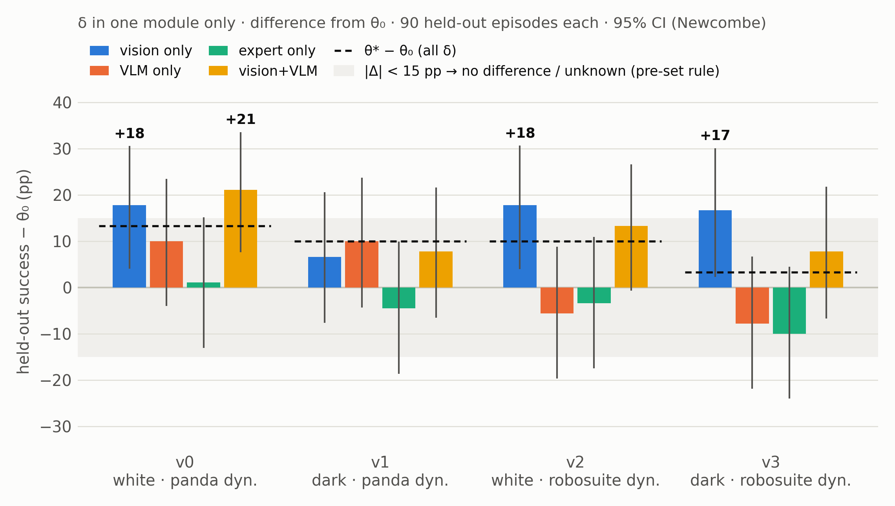
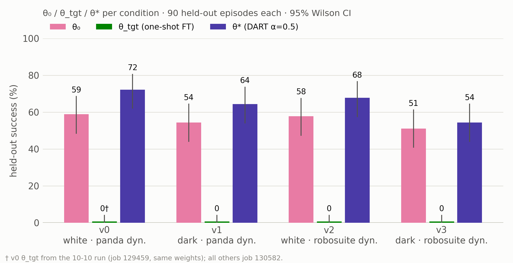

# 실험 6 결과 — 몸체 차이 분해 (2×2: 색 × 동역학), Panda → xArm7, LIBERO libero_spatial

평가 2026-10-21~23 (잡 130582, ece-agpu7) · 집계 2026-10-27 (잡 131055, ece-agpu14, 새 실행 없음).
질문: 몸체 차이(Panda→xArm7)의 도메인 벡터 δ 는 어느 모듈에 담기나 — H1 시각 가설 (vision+VLM) / H2 액션 가설 (action expert).
조건: v0 white·panda (기준) / v1 dark·panda (색만) / v2 white·robosuite (동역학만) / v3 dark·robosuite (둘 다). 조건별 절차·검증은 `EXP6_LOG.md`.

## 결론

1. **사전 규칙(조건별 |차이| ≥ 15%p 만 차이로 씀)으로는 2×2 예측 6칸을 모두 판정할 수 없다.**
   색·동역학을 바꿔도 θ0 가 15%p 이상 떨어지지 않았다 (v0 대비 v1 −4.4, v2 −1.1, v3 −7.8%p). 그래서 "시각 성분은 __, 동역학 성분은 __" 의 빈칸을 조건별 비교로는 채우지 못한다.
   조건별로 15%p 를 넘은 것은 **δ 를 vision 에만 넣은 모델 (v0·v2·v3 에서 θ0 대비 +17~18%p)** 과 v0 의 vision+VLM (+21%p) 뿐이다. expert 에만 넣은 모델은 어느 조건에서도 15%p 를 넘지 않았다.
2. **사후 분석(결과를 본 뒤 추가한 4조건 합산 CMH 검정)으로는 H1 의 vision 쪽만 지지된다.**
   "몸체 차이의 시각 성분(네 조건 모두에 있는 xArm7 외형)은 vision 인코더에 담기고, 동역학 성분은 action expert 에서 검출되지 않는다."
   - vision 만: θ0 대비 +14.7%p (p=6e-5).
   - expert 만: θ* 대비 −13.3%p (p=4e-4). 동역학을 바꾼 v2·v3 에서도 같다.
   - VLM 만: θ0 대비 +1.7%p (p=0.71) 로 H1 의 VLM 부분은 지지되지 않는다.
   - H2 는 지지되지 않는다.
3. **색 손잡이와 동역학 손잡이 모두 θ0 에 약했다** (교란 점검 b). 색만 더 바꾼 v1 에서 vision 효과가 커지지도 않았다 (+6.7%p, v0 는 +17.8%p). 그래서 위 결론은 "색 차이" 가 아니라 **모든 조건에 공통인 xArm7 외형 차이**에 대한 것으로 약하게 읽어야 한다.

## 1. 마스터 표 (held-out t1–9 성공률 %, 각 90회, 괄호 = Wilson 95% CI)

| 조건 | θ0 | θ_tgt | θ* α=0.5 | δ→vision | δ→VLM | δ→expert | δ→vision+VLM | θ*−θ0 (%p) | 회복률 % (vision / VLM / expert / vision+VLM) | 데모 클립 ±1 / 회전 | FT step-0 loss |
|---|---|---|---|---|---|---|---|---|---|---|---|
| v0 white · panda | 59 (49–68) | 0 (0–4)† | 72 (62–80) | 77 (67–84) | 69 (59–78) | 60 (50–70) | 80 (71–87) | +13.3 | 133 / 75 / 8 / 158 | 28% / 34% | 0.1218 |
| v1 dark · panda | 54 (44–64) | 0 (0–4) | 64 (54–74) | 61 (51–71) | 64 (54–74) | 50 (40–60) | 62 (52–72) | +10.0 | 67 / 100 / -44 / 78 | 28% / 34% | 0.1398 |
| v2 white · robosuite | 58 (47–67) | 0 (0–4) | 68 (58–77) | 76 (66–83) | 52 (42–62) | 54 (44–64) | 71 (61–79) | +10.0 | 178 / -56 / -33 / 133 | 29% / 13% | 0.1260 |
| v3 dark · robosuite | 51 (41–61) | 0 (0–4) | 54 (44–64) | 68 (58–77) | 43 (34–54) | 41 (32–51) | 59 (49–68) | +3.3 | 500 / -233 / -300 / 233 | 29% / 13% | 0.1456 |
| **합산 (360회)** | 56 (50–61) | 0 (0–1) | 65 (60–69) | 70 (65–75) | 57 (52–62) | 51 (46–57) | 68 (63–73) | +9.2 | — | — | — |

† v0 θ_tgt 는 같은 잡 실행이 없어 10-10 실행 (잡 129459, 같은 가중치) 값.

- 회복률 = (마스크 − θ0)/(θ* − θ0). 분모 θ* − θ0 가 모든 조건에서 15%p 미만이라 부트스트랩 95% 구간이 수백 %p 폭이다 (조건별 구간은 `results/<cond>_exp6_tables.md`). **회복률은 참고값이고, 비교는 아래 2절의 "마스크 − θ0" 로 한다.**
- 데모 클립: ±1 = 정규화 액션이 상한 ±1 로 잘린 프레임 비율, 회전 = rot-clip (norm q01~q99) 으로 잘린 프레임 비율 (단계 1 검증표). step-0 loss = 학습 전 θ0 가 그 조건 타깃 데모에서 낸 loss (단계 2, 배치 하나).

**그림 1** — δ 를 한 모듈에만 넣었을 때 θ0 대비 held-out 성공률 차이 (%p, Newcombe 95% CI). 점선 = θ* − θ0 (δ 전부). 회색 띠 = |차이| < 15%p (사전 규칙상 "차이 없음/모름").

**그림 2** — 조건별 θ0 / θ_tgt / θ* held-out 성공률 (Wilson 95% CI). θ_tgt 는 네 조건 모두 0%.

## 2. 모듈별 효과 — 조건별 판정 (사전 규칙)

셀 = 마스크 − θ0 (held-out %p), 괄호 = Newcombe 95% CI, p = Fisher exact (90 vs 90).

| δ 를 넣은 모듈 | v0 white · panda | v1 dark · panda | v2 white · robosuite | v3 dark · robosuite |
|---|---|---|---|---|
| vision only | +17.8 (+4, +31) p=0.016 **↑** | +6.7 (-8, +21) p=0.45 – | +17.8 (+4, +31) p=0.017 **↑** | +16.7 (+2, +30) p=0.033 **↑** |
| VLM only | +10.0 (-4, +23) p=0.21 – | +10.0 (-4, +24) p=0.22 – | -5.6 (-20, +9) p=0.55 – | -7.8 (-22, +7) p=0.37 – |
| expert only | +1.1 (-13, +15) p=1 – | -4.4 (-19, +10) p=0.65 – | -3.3 (-17, +11) p=0.76 – | -10.0 (-24, +4) p=0.23 – |
| vision+VLM | +21.1 (+8, +34) p=0.0034 **↑** | +7.8 (-7, +22) p=0.36 – | +13.3 (-1, +27) p=0.086 – | +7.8 (-7, +22) p=0.37 – |
| θ* (전부) | +13.3 (-1, +27) p=0.084 – | +10.0 (-4, +24) p=0.22 – | +10.0 (-4, +24) p=0.22 – | +3.3 (-11, +18) p=0.77 – |

↑/↓ = 15%p 이상 차이, – = 차이 없음/모름.

## 3. 가설 대조

실험 전 예측 (노션 "[6] 몸체 차이 분해 실험 설계" §3, 2026-10-21 기록, 고치지 않음):

| | H1 시각 가설이 맞으면 | H2 액션 가설이 맞으면 |
|---|---|---|
| V1 (시각만) | θ₀ 떨어짐, 회복은 **vision+VLM** 마스크에서 | θ₀ 거의 안 떨어짐 |
| V2 (액션만) | θ₀ 거의 안 떨어짐, expert 마스크 효과 없음 | θ₀ 떨어짐, **expert** 마스크 회복률 ↑ |
| V3 (둘 다) | V1과 비슷 | V1+V2 합 근처 (가산적인지가 보너스 결과) |

칸별 판정 (○ = 예측 방향으로 15%p 이상, ✕ = 반대 방향 또는 "그대로" 예측인데 15%p 이상, ? = 15%p 미만이라 차이 없음/모름):

| | H1 시각 | H2 액션 |
|---|---|---|
| V1 | **?** — θ0 −4.4, vision+VLM −θ0 +7.8 | **?** — θ0 −4.4 (차이 없음, 모순 없음) |
| V2 | **?** — θ0 −1.1, expert −θ0 −3.3 (둘 다 차이 없음, 모순 없음) | **?** — 예측한 θ0 하락·expert 상승이 15%p 이상으로 안 나타남 |
| V3 | **?** — v1 과의 차이 θ0 −3.3, vision+VLM 0.0 | **?** — 가산 대비 −2.2 |

세부 항목:

| 셀 | 가설 | 예측 항목 (관찰값 %p) | 판정 |
|---|---|---|---|
| V1 | H1 | θ0 하락 (v1 θ0 − v0 θ0): **-4.4** | ? 모름 (15%p 미만) |
| V1 | H1 | 회복은 vision+VLM (v1 vision+VLM − θ0; 격차 θ*−θ0 = +10.0): **+7.8** | ? 모름 (15%p 미만) |
| V1 | H2 | θ0 거의 유지 (v1 θ0 − v0 θ0): **-4.4** | ? 차이 없음 (모순 없음) |
| V2 | H1 | θ0 거의 유지 (v2 θ0 − v0 θ0): **-1.1** | ? 차이 없음 (모순 없음) |
| V2 | H1 | expert 효과 없음 (v2 expert − θ0): **-3.3** | ? 차이 없음 (모순 없음) |
| V2 | H2 | θ0 하락 (v2 θ0 − v0 θ0): **-1.1** | ? 모름 (15%p 미만) |
| V2 | H2 | expert 회복 ↑ (v2 expert − θ0): **-3.3** | ? 모름 (15%p 미만) |
| V3 | H1 | V1 과 비슷: θ0 하락 v3 − v1: **-3.3** | ? 차이 없음 (모순 없음) |
| V3 | H1 | V1 과 비슷: vision+VLM 효과 v3 − v1: **+0.0** | ? 차이 없음 (모순 없음) |
| V3 | H2 | V1+V2 합 근처: θ0 하락 v3 − (v1 + v2): **-2.2** | ? 차이 없음 (모순 없음) |
| V3 | H2 | (H2 함의) expert 효과 v3: **-10.0** | ? 모름 (15%p 미만) |

**예측과 다른 점**
- 두 가설 모두 한 조건에서 θ0 가 떨어진다고 예측했다 (H1: V1, H2: V2). 그런데 어느 조건에서도 θ0 하락이 15%p 를 넘지 않았다.
  작은 하락이 있었는지는 이 표본으로 알 수 없다.
- H1 은 V1 의 회복이 vision+VLM 에서 일어난다고 예측했다. 그러나 V1 은 θ* − θ0 격차 자체가 +10%p 라 회복을 판정할 수 없다.
  오히려 vision 만 넣은 효과가 네 조건 중 가장 작은 곳이 V1 이다 (+6.7%p).
- 예측표에 없던 결과: vision 만 넣은 효과가 동역학만 바꾼 V2 에서도 컸다 (+17.8%p). 이 효과는 기준 조건 v0 에도 같은 크기로 있다 (+17.8%p).
  따라서 V2 의 동역학 변화보다는 모든 조건에 공통인 xArm7 외형 차이에서 온 것으로 보인다 (추정).

## 4. 합산 검정 — 사후 분석 (결과를 본 뒤 추가)

조건별 2×2 표를 층으로 둔 Cochran–Mantel–Haenszel 검정 (연속성 보정). 단계 3 에서 처음 계산했고, 실험 설계 때 정한 분석이 아니다. 비교가 8개라 Bonferroni 기준은 0.05/8 = 0.006 이다.

| 비교 | 차이 (합산 %p) | MH 공통 OR | CMH p | 조건별 부호 (v0 v1 v2 v3) | Bonferroni (0.05/8) |
|---|---|---|---|---|---|
| θ* vs θ0 | +9.2 | 1.47 | 0.015 | + + + + | — |
| vision vs θ0 | +14.7 | 1.90 | 5.9e-05 | + + + + | 통과 |
| vision+VLM vs θ0 | +12.5 | 1.71 | 0.0007 | + + + + | 통과 |
| VLM vs θ0 | +1.7 | 1.07 | 0.71 | + + − − | — |
| expert vs θ0 | -4.2 | 0.84 | 0.29 | + − − − | — |
| vision vs θ* | +5.6 | 1.29 | 0.13 | + − + + | — |
| expert vs θ* | -13.3 | 0.57 | 0.00035 | − − − − | 통과 |
| VLM vs θ* | -7.5 | 0.72 | 0.045 | − = − − | — |

- VLM 만 넣은 경우를 동역학으로 나누면: panda (v0+v1) θ0 대비 +10.0%p (p=0.065), robosuite (v2+v3) −6.7%p (p=0.25). VLM δ 가 동역학과 상호작용한다는 가설만 낼 수 있다.

## 5. 교란 점검

- **(a) 데모 클립 비율 — 해당 없음.**
  - ±1 클립: v0 28% → v2·v3 29% (+1%p).
  - 회전 클립: 34% → 13%.
  - Δz 상한 초과: 22% → 12%.
  - robosuite 동역학 데모가 오히려 덜 잘렸다. 그래서 "액션 손잡이가 상한에 걸려 데모에 일부만 담겼다" 는 해석은 필요 없다.
- **(b) v1 θ0 ≈ v0 θ0 — 해당 (결론을 약하게 씀).**
  - v1 θ0 54% vs v0 59% (−4.4%p, 15%p 미만). θ0 는 같은 설정에서도 실행마다 54~59% 로 흔들린다.
  - 규칙대로 색 손잡이가 약했다고 본다. 같은 기준으로 동역학 손잡이도 약했다 (v2 −1.1%p).
  - 반대 근거도 있다. step-0 loss 는 v1 이 v0 보다 15% 높았다 (0.1398 vs 0.1218, 배치 하나). δ_vision 방향도 v1 에서 가장 많이 바뀌었다 (v0 대비 cos 0.586, 단계 2).
  - 즉 모델 입력·학습에서는 색 차이가 보였지만 성공률 차이로는 나타나지 않았다.
- **(c) 가산성 — 판정 불가.**
  - θ0 하락: v3 −7.8%p vs v1 + v2 = −5.6%p. 차이 −2.2%p 로 15%p 미만이다.
  - 연속 지표인 step-0 loss 상승: v3 +0.0238 vs v1 + v2 +0.0222. 거의 가산적이다 (배치 하나의 추정치).

## 6. 관찰

1. **DART 자체:**
   - θ* 는 네 조건 모두 θ_tgt (held-out 0%) 를 압도한다 (p ≤ 4e-19, 단계 3).
   - θ0 대비 이득은 +3~13%p 로, 조건별로는 15%p 미만이다. 합산하면 +9.2%p (p=0.015, 사후 분석).
   - 색·동역학을 둘 다 바꾼 v3 에서 가장 작다 (+3.3%p).
2. **vision 만 > θ* (합산 +5.6%p, p=0.13, 유의하지 않음).** "vision 외 부분의 δ 는 도움이 안 되거나 방해한다" 는 신호다.
   δ 를 vision 에만 쓰는 변형을 검증하려면 이 결과로 고르지 않은 새 seed·태스크가 필요하다 (α 와 같은 순환 문제).
3. **실패 모드 (단계 3, θ* ep0 실패 영상 14개):**
   - 모두 시간초과였다. 파지 실패 6, 놓기 실패 3, 목표 앞 정체 4, 엉뚱한 물체 1.
   - "덜 움직여서 못 닿음" 은 0건이다. 동역학 조건에서도 도달 문제는 없었다.
4. **δ 방향 (단계 2, 보조 지표):**
   - 조건이 바뀌어도 δ 크기는 같다 (노름비 0.99~1.01).
   - 방향은 expert 가 가장 덜 바뀌고 (cos 0.64~0.78), vision 이 가장 많이 바뀐다 (0.47~0.59). 동역학만 바꾼 v2 에서도 그렇다.
   - FT 잡음 기준선이 없어 해석은 보류한다.

## 방법 메모

- 성공률: held-out = t1~9 × 10 에피소드 = 90회 (t0 는 adaptation 태스크라 제외). 95% CI 는 Wilson, 차이의 CI 는 Newcombe (Wilson 결합).
  같은 공식 초기 상태 0~9 를 쓰지만 pi05 행동 샘플링이 확률적이어서 독립 표본으로 취급했다 (단계 0~3 의 Fisher 와 같은 가정).
- 판정 규칙 (사전): 조건당 90회에서 두 비율의 차이가 대략 15%p 를 넘어야 p<0.05 가 된다. 그래서 15%p 미만 차이는 "차이 없음/모름" 으로만 썼다.
  "그대로" 를 예측한 칸은 15%p 미만이면 "모순 없음 (?)" 으로 두고 ○ 를 주지 않았다. 차이가 없음을 이 표본으로 입증할 수 없기 때문이다.
- 회복률·부트스트랩 구간은 `summarize_exp6.py` (단계 0·3) 의 `results/exp6_summary.json` 값을 그대로 썼다 (2000회, seed 0).
- 합산 검정: CMH (연속성 보정) + MH 공통 OR. 단계 3 과 같은 식이며 같은 값이 나오는 것을 확인했다.
- 평가 프로토콜 (모든 조건 동일):
  - seed 7, 클라이언트 5개, 최대 220 스텝, 5 스텝 재계획.
  - 서버: θ0·θ*·θ_tgt 는 `serve_ckpt.py`, 마스크는 `serve_masked.py` (none/all ≡ θ0/θ* 비트 동일 확인, 단계 0).
  - 색·동역학 env 는 `exp6_cond.sh` 한 곳에서만 정하고 클라이언트 프로세스에 적용했다. 21개 모두 jsonl 기록값이 조건과 일치했다.
- 그림 색: 그림 1 은 기본 범주형 팔레트 1~4번, 그림 2 는 5~7번. 인접 색약 구분 ΔE ≥ 9.1 로 검증했다. 대비가 3:1 미만인 색은 표 1 이 값을 함께 제공한다.
- 스크립트: `exp6_results.py` (이 문서의 표·그림 전부). 단계별 러너는 `EXP6_LOG.md` 의 "신규·수정 파일" 참고.

## 원자료

- 평가: `results/<cond>_<model>/client*.jsonl`, `summary.txt`, `meta.txt` (v0 θ_tgt 는 `results/theta_tgt/`, 10-10 실행).
- 집계: `results/exp6_master.json`, `results/exp6_master_tables.md`, `results/exp6_summary.json`, `results/<cond>_exp6_tables.md`.
- 데모 검증: `results/exp6_demos/stage1_check.json`.
- FT 로그 (git 제외, 서버 홈): `logs/oneshot_ft/tgt_mem0.9_bs64.log` (v0), `logs/oneshot_ft_exp6/<cond>_tgt_mem0.9_bs64.log`.
- 실패·환경 확인 프레임 (git 제외, 서버 홈): `renders/exp6_eval/`.
- 평가 영상은 잡 130582 의 `/dev/shm` (휘발성) 에만 있었다. v0 와 같은 가중치의 10-10 실행 영상은 `results/videos/` (git 제외).
- 체크포인트: HF 비공개 `qoranreh/dart-xarm7-oneshot` (`oneshot_src/`, `oneshot_tgt/`, `dart_a0.5/`, `v{1,2,3}/oneshot_tgt/`, `v{1,2,3}/dart_a0.5/`). 2026-10-27 파일 수·크기 확인.

## 한계

1. **suite 1개 (libero_spatial), 태스크당 10회, 조건당 1회 실행 (seed 7 하나).**
   - 모델당 held-out 90회라 15%p 미만 차이는 판단할 수 없다.
   - θ0 도 같은 설정에서 실행마다 54~59% 로 흔들린다.
2. **α=0.5 고정.**
   - 처음에는 v0 의 전체 평가 결과로 고른 값이다 (10-09·11).
   - 단계 0 에서 초기 상태 0~4 의 held-out 만으로 다시 골라도 α=0.5 가 1위였다. 보고용 5~9 에서 76% vs θ0 53% (p=0.047).
   - 조건별로 다시 고르지 않았다.
3. **rot-clip 과 norm stats.**
   - 타깃 데모의 회전 보정을 Panda norm q01~q99 로 잘랐다 (rot-clip).
   - norm stats 는 다시 계산하지 않고 θ0 (Panda·LIBERO) 것을 그대로 썼다.
4. **네이티브 동역학 (XARM7_DYNAMICS=robosuite) 은 묶음이다.** 관절 마찰 (frictionloss 1) 과 그리퍼 속도 (0.2) 를 함께 바꿨다. 그래서 v2·v3 는 "동역학 묶음" 효과이고, 마찰만 바꾼 중간 조건은 하지 않았다.
5. **v0 의 도메인 차이를 작게 맞췄다** (흰색, Panda 규약 동역학, 그리퍼·손목 카메라 정렬).
   - θ0 가 이미 51~59% 이고 θ* − θ0 격차는 3~13%p 라 회복률은 해석할 수 없다.
   - 2×2 는 모든 조건에 공통인 xArm7 외형 차이 위에 얹은 추가 색·동역학 변화만 나눈다.
6. **OSMesa 렌더.** EGL 을 못 써서 공식 평가와 렌더러가 다르다.
7. **사후 분석과 다중 비교.** 합산 검정은 결과를 본 뒤 추가한 사후 분석이다. 비교 8개 중 Bonferroni 0.006 을 넘는 것은 3개다.
8. **그 밖에:**
   - FT 잡음 기준선 (v0 재학습) 이 없다.
   - v0 θ_tgt 는 다른 잡 (10-10) 의 실행값이다.
   - 색은 dark (0.15 회색) 한 가지만 시험했다.
